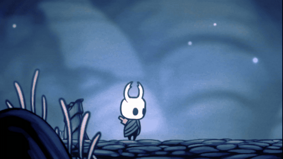

# Stumble

Every so often while running, our hero will trip, fall
flat on their face, and have to pick themselves back up.

## Installation

Install with **Lumafly**: search for Stumble and click Install. Lumafly also
sets up the Modding API, which Stumble needs (Hollow Knight 1.5).

To install by hand, download `Stumble.zip` from the
[latest release](../../releases/latest) and extract it into
`hollow_knight_Data/Managed/Mods/Stumble/`.

## What happens

- They can trip whenever they're walking or running along the ground, and
  when they finish a dash on the ground.
- They slide forward with their momentum, fall, and stay down until you press
  left or right once again.
- Getting hit while they're down knocks them back as usual.
- With the Mantis Claw, they can lose their grip as they catch a wall, or
  while clinging to one. A spark marks the spot. They drop off and can't grab
  a wall or wall-jump again until they land or a moment passes. Even a failed
  grab gives back their double jump and dash, as touching a wall always does.
  The slip startles them, so a jump pressed right as they lose their grip
  does nothing, but a quick double jump or dash a beat later might still save
  them.

## Options

In the game, go to **Options > Mods > Stumble**.

| Menu Option | What it does |
|---|---|
| Stumble | Turns the mod on or off. |
| Knight Clumsiness | How often they trip: Low, Medium (default), High or Very High. |
| Wall Clumsiness | How often they lose their grip on walls: Off, Low, Medium (default), High or Very High. |
| Detailed Logging | Extra detail in the game's log, for reporting problems. |

## Good to know

- They can't trip mid-dash, while jumping, healing or using Shape of Unn. If
  you're determined, you can hop your way around Hallownest.
- The map and inventory can't be opened while they're down. The pause menu still
  works.
- Tripping into a cutscene keeps them down until it's over.
- Falling into water, or acid with Isma's Tear, ends the trip just before the
  splash, so swimming works normally.
- The bouncy mushrooms in Fungal Wastes don't bounce a tripped Knight. They just
  faceplant. This is intentional.
- A trip isn't damage, so it won't break the Delicate Flower.
- How often they trip doesn't depend on your frame rate.

## Reporting problems

1. Turn on **Detailed Logging** in the Stumble options.
2. Make the problem happen again.
3. [Open an issue](../../issues) describing what happened, and attach
   `ModLog.txt` and a list of your other installed mods.

`ModLog.txt` is in the game's save folder:

- Windows: `%AppData%\..\LocalLow\Team Cherry\Hollow Knight`
- macOS: `~/Library/Application Support/unity.Team Cherry.Hollow Knight`
- Linux: `~/.config/unity3d/Team Cherry/Hollow Knight`

## Credits

Made by TCM, with help from Claude (Anthropic).

Building the mod from source is covered in [DEVELOPING.md](DEVELOPING.md).
